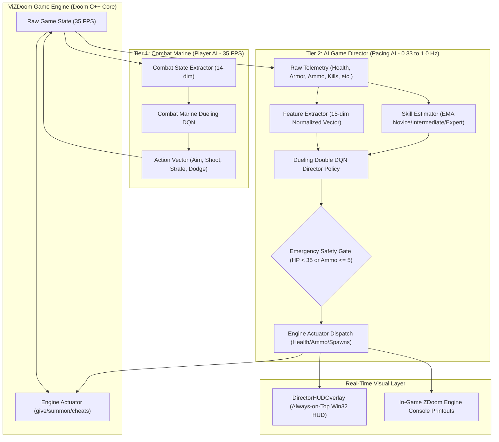

# Adaptive Game Director: Complete Project Architecture & System Guide

**Submitted by:**
- **Mohammad Anaan Ansari** [Reg No: `RA2411026030055`]
- **Lekkala Phanidhar Reddy** [Reg No: `RA2411026030032`]
- **Aryan Parmar** [Reg No: `RA2411026030034`]

An end-to-end technical guide explaining the design, inner mechanics, and reinforcement learning architecture of the **Adaptive Game Director** and **Combat Marine** co-evolution system built on the **ViZDoom** engine.

---

## 1. Project Vision & Executive Summary

In traditional video games, difficulty is typically fixed (Easy, Normal, Hard) or relies on simplistic, reactive heuristics (e.g. rubber-banding). Static difficulty inevitably causes:
1. **Frustration / Distress:** When a player encounters an unfair difficulty spike, takes lethal damage, or runs out of ammunition, leading to rage-quits.
2. **Boredom / Disengagement:** When an experienced player cruises through a level at 100% health without tension or challenge.

According to Mihaly Csikszentmihalyi's **Flow Theory**, optimal engagement occurs within the **Flow Channel**—a dynamic equilibrium where the game's challenge perfectly balances the player's evolving skill:

```
HIGH CHALLENGE  ▲  [ Anxiety / Distress ]   (Health < 35 HP, Ammo = 0)
                │          \
                │           \═══► [ FLOW CHANNEL ] ◄═══  (Health 35 - 75 HP)
                │                       /
LOW CHALLENGE   │  [ Boredom / Comfort ]    (Health > 75 HP, Zero Threat)
                └────────────────────────────────────────►
                  LOW SKILL                     HIGH SKILL
```

This project implements a **Dual-Agent Co-Evolution Reinforcement Learning Ecosystem**:
1. **The Combat Marine Agent (`combat_marine_dqn.pt`):** An autonomous player AI learning 3D aiming, circle-strafing, evasive fire, target tracking, and weapon auto-equipping.
2. **The Adaptive Game Director (`director_dqn.pt`):** An intelligent pacing AI monitoring 15 continuous player telemetry dimensions, evaluating player skill, and issuing real-time difficulty modulations (resource drops, monster pacing, and skill tuning) to maximize time spent in the **Flow Channel (`[35, 75 HP]`)**.

---

## 2. High-Level System Architecture: The Two-Tier Dual Loop

The project is architected around two asynchronous, interacting loops running at different temporal cadences:



### The Two Loops Explained:
- **Inner Loop (High-Frequency: 35 FPS):** Controls the player character (either a Human via SPECTATOR mode or the autonomous `CombatAgent` via PLAYER mode). Handles tactical aiming, shooting, movement, and weapon auto-equipping.
- **Outer Loop (Low-Frequency: Every 1.0 to 3.0 Seconds / 35-105 tics):** Runs the `DQNAgent` Game Director. Evaluates 10-second rolling performance trends, estimates player skill, and calculates the Flow State reward before modulating difficulty parameters.
- **Emergency Interrupt (Asynchronous):** If player health drops below 35 HP or weapon ammo falls to $\le 5$, the Director immediately interrupts the 3-second cycle (with a 1-second cooldown) to dispatch emergency relief.

---

## 3. Detailed Component Breakdown

### 3.1. Reinforcement Learning Engine (`src/agent/`)

#### 1. Dueling Double Deep Q-Network (`network.py`)
Both the Combat Agent and the Game Director utilize a **Dueling Q-Network** architecture. Standard DQNs directly predict $Q(s, a)$. In contrast, Dueling DQN decomposes $Q(s, a)$ into two distinct streams:
$$\mathcal{Q}(s, a; \theta, \alpha, \beta) = \mathcal{V}(s; \theta, \beta) + \left( \mathcal{A}(s, a; \theta, \alpha) - \frac{1}{|\mathcal{A}|} \sum_{a'} \mathcal{A}(s, a'; \theta, \alpha) \right)$$
- **State-Value Stream $\mathcal{V}(s)$:** Learns how favorable a game situation is, independent of which action is chosen. (e.g. low health in a horde is inherently dangerous regardless of action).
- **Advantage Stream $\mathcal{A}(s, a)$:** Learns the relative importance of each action compared to the average.

#### 2. Double DQN (Decoupled Action Selection and Evaluation)
Standard Q-learning suffers from overestimation bias. Double DQN decouples action selection from target evaluation using the online network $\theta$ and target network $\theta^-$:
$$Y_t^{DoubleQ} = R_{t+1} + \gamma \mathcal{Q}\left(S_{t+1}, \arg\max_a \mathcal{Q}(S_{t+1}, a; \theta_t); \theta_t^-\right)$$
This completely extinguished **superstitious wall-firing** in early training.

#### 3. Prioritized Experience Replay (PER) via Binary `SumTree` (`replay_buffer.py`)
Instead of uniformly sampling random transitions where 90% are uninformative rotations, transitions are prioritized by their temporal-difference (TD) error:
$$P(i) = \frac{p_i^\alpha}{\sum_k p_k^\alpha}, \quad p_i = |\delta_i| + \epsilon$$
- Stored in a binary **SumTree** with $\mathcal{O}(\log N)$ insertion and sampling.
- Corrected for sampling bias using importance-sampling weights:
$$w_i = \left( \frac{1}{N \cdot P(i)} \right)^\beta$$

#### 4. Soft Target Updates (Polyak Averaging)
Target network weights are smoothly blended every step rather than hard-copied every 1,000 steps:
$$\theta^- \leftarrow \tau \theta + (1 - \tau) \theta^-, \quad \tau = 0.005$$

---

### 3.2. Combat Marine Agent (`src/agent/combat_agent.py`)

The player AI perceives a 14-dimensional normalized combat state:
1. `enemy_visible`: Whether an enemy actor is detected.
2. `angle_to_enemy`: Horizontal angular offset $[-1, 1]$.
3. `distance_to_enemy`: Normalized proximity to closest threat.
4. `health`: Current HP normalized to $[0, 1]$.
5. `armor`: Current Armor normalized to $[0, 1]$.
6. `ammo`: Current weapon ammo normalized to $[0, 1]$.
7. `is_firing`: Whether player fired in previous tic.
8. `hit_feedback`: Hit confirmation flag.
9. `damage_taken`: Recent damage sustained.
10. `enemy_count`: Normalized count of visible adversaries.
11. `velocity_x`, `velocity_y`: 2D movement momentum.
12. `on_target`: Binary indicator ($1.0$ if crosshair aligns within $\pm 6^\circ$ of threat).
13. `weapon_tier`: Current equipped weapon category (1: Pistol to 5: BFG).

**Action Space (7 Discrete Tactical Behaviors):**
- `0: TURN_LEFT` — Snap aim left toward target.
- `1: TURN_RIGHT` — Snap aim right toward target.
- `2: ATTACK` — Fire active weapon.
- `3: MOVE_FORWARD` — Advance to close combat range.
- `4: MOVE_FORWARD_ATTACK` — Push forward while firing.
- `5: STRAFE_LEFT_ATTACK` — Circle-strafe left while firing.
- `6: STRAFE_RIGHT_ATTACK` — Circle-strafe right while firing.

**Automated Weapon Selection:**
If the Marine picks up a shotgun, chaingun, or rocket launcher, the agent immediately issues a weapon switch command (`SELECT_WEAPON6` through `3`), discarding the default pistol.

---

### 3.3. Player Modeling & Telemetry (`src/player_model/`)

#### 1. Feature Engineering (`features.py`)
Computes real-time online metrics over a 10-second rolling window:
- `kill_rate`: Kills per second.
- `death_rate`: Deaths per second.
- `damage_dealt_rate`: Damage inflicted per second.
- `damage_received_rate`: Damage intake velocity per second.
- `accuracy_estimate`: Ratio of successful damage hits to shots fired.
- `player_speed`: Normalized velocity magnitude $\sqrt{v_x^2 + v_y^2}$.
- `recent_performance_trend`: Linear trend slope of health delta $[-1, 1]$.
- `aggression_score`: Forward movement combined with firing frequency.

The Director ingests a **15-Dimensional Normalized State Vector $\mathbf{s}_t \in \mathbb{R}^{15}$**:
`[norm_health, norm_armor, norm_ammo, norm_kills, norm_deaths, kill_rate, death_rate, damage_dealt_rate, damage_received_rate, accuracy, player_speed, enemy_count, recent_trend, aggression, player_skill_estimate]`.

#### 2. Skill Estimation (`skill_estimator.py`)
Maintains an Exponential Moving Average (EMA) skill score $S_t \in [0.0, 1.0]$:
$$S_t = (1 - \alpha) S_{t-1} + \alpha \cdot \text{Performance}_t, \quad \alpha = 0.05$$
Classifies players into three categorical tiers:
- **`NOVICE` ($S_t < 0.35$):** Player misses shots, takes frequent hits. Director provides protective pacing and aid drops.
- **`INTERMEDIATE` ($0.35 \le S_t \le 0.75$):** Balanced combat capability. Director maintains dynamic Flow State tension.
- **`EXPERT` ($S_t > 0.75$):** High accuracy and kill efficiency. Director escalates monster density and aggression.

---

### 3.4. Dynamic Difficulty Adjustment & Engine Actuation (`src/dda/`)

#### 1. Action Space (`difficulty.py`)
The Game Director chooses one of 7 discrete actions:
- `0: NO_CHANGE` — Maintain current engine and pacing parameters.
- `1: INCREASE_DIFFICULTY` — Escalate challenge; spawn high-tier threats (Cacodemons, Revenants, Hell Knights).
- `2: DECREASE_DIFFICULTY` — De-escalate challenge; drop emergency Stimpacks (+15 HP, +20 Ammo).
- `3: INCREASE_ENEMY_SPAWN` — Introduce monster waves (Imps if HP < 55, Pinky Demons if HP $\ge$ 55).
- `4: DECREASE_ENEMY_SPAWN` — Thin hostile horde (`kill monsters`).
- `5: INCREASE_RESOURCES` — Deliver emergency Medikit (+25 HP) and Ammo (+50 Clip).
- `6: DECREASE_RESOURCES` — Withhold pickup drops.

#### 2. Engine Actuation & Safety Envelopes (`difficulty.py`)
ViZDoom commands are dispatched via ZDoom's internal console engine.
- `sv_cheats 1` is automatically ensured so commands are recognized.
- **Direct Inventory Replenishment + In-World Spawns:**
  Because stationary scenarios (like `defend_the_center`) disable forward/backward movement, floor spawns alone cannot be reached. When `INCREASE_RESOURCES` triggers, the actuator executes:
  1. `give health 25` (immediately restores +25 HP on HUD)
  2. `give clip 50` (immediately loads +50 bullets into inventory)
  3. `summon Medikit` and `summon ClipBox` (spawns 3D physical pickups in the arena)
- **Unconditional Emergency Guardrails:**
  - If `player_ammo <= 5`: Force `action = INCREASE_RESOURCES`.
  - If `player_health < 35.0`: Force `action = INCREASE_RESOURCES`.

#### 3. Live HUD Overlay Banner (`overlay.py`)
A standalone borderless Pygame window created using Win32 API `ctypes.windll.user32.SetWindowPos` with `HWND_TOPMOST` and `SWP_NOACTIVATE`. It docks at the top of the screen during human and bot play without stealing keyboard or mouse focus, displaying:
- Difficulty Level (`EASY / MEDIUM / HARD / NIGHTMARE`)
- Assessed Player Tier (`NOVICE / INTERMEDIATE / EXPERT`)
- Flow Tension Meter (`[35, 75 HP]` target zone with live HP marker)
- Active Director Action (`[AID] +25 HP & 50 Ammo Delivered`)
- Synchronized in-game console printouts (`print "..."`).

---

### 3.5. Flow State Reward Formulation (`src/rewards/reward_functions.py`)

The Game Director is trained via a multi-objective reward formulation:
$$R_{director} = R_{health\_balance} + R_{combat\_engagement} - P_{death} - P_{boredom}$$

1. **Flow Channel Balance ($R_{health\_balance}$):**
   A Gaussian bell curve centered at the ideal tension median ($\mu = 55$ HP, $\sigma = 20$):
   $$R_{health\_balance} = \exp\left( - \frac{(\text{health} - 55)^2}{2 \times 20^2} \right)$$
   Yields maximum reward ($+1.0$) when health hovers in the sweet spot $[35, 75]$ HP.
2. **Combat Engagement ($R_{combat\_engagement}$):**
   Rewards active projectile hits, enemy eliminations, and close-quarters combat.
3. **Frustration / Death Penalty ($P_{death}$):**
   Severe penalty ($-2.0$) if the player dies, penalizing unfair difficulty spikes.
4. **Boredom Penalty ($P_{boredom}$):**
   Penalizes sitting at 100% health for prolonged periods without engaging enemies.

---

### 3.6. ViZDoom Environment & Map Augmentation (`src/environment/`)

#### 1. Gymnasium Environment (`vizdoom_env.py`)
A standard Gymnasium-compliant environment (`gym.Env`) wrapper:
- Steps multiple game tics (e.g. 105 tics = 3 seconds) per RL decision step.
- Automatically handles headless spectator observation extraction and bot persona execution.

#### 2. WAD Manipulation Tools (`wad_tools.py`)
Powered by `omgifol` (`omg`), allows programmatic inspection and modification of Doom binary maps:
- Scans `THINGS` lumps to count monsters, health bonuses, armor, weapons, and player starts.
- Injects custom supply depots, monster ambush zones, and dynamic teleport destinations.

---

## 4. Execution Scripts & Workflows

### 4.1. Visual Parallel Training Surveillance Grid
```powershell
python scripts/visual_training_grid.py --grid-size 4 --mode co_evolution
```
- Opens a multi-window matrix (2x2 or 2x3) running parallel ViZDoom instances.
- **Autonomous Curriculum Progression:** Tiles start on `defend_the_center.cfg` (Tier 1) and automatically graduate to `defend_the_line.cfg` (Tier 2), `deadly_corridor.cfg` (Tier 3), and `deathmatch.cfg` (Tier 4) as rolling average kills cross milestone thresholds.
- Press `Q` or `ESC` to save weights to `models/final/`.

### 4.2. Interactive Human Gameplay with Live AI Director
```powershell
# Option 1: Live human play with DQN Director + Topmost HUD
python scripts/play_human.py --scenario defend_the_center.cfg

# Option 2: Live human play via run_dqn_dda.py
python scripts/run_dqn_dda.py --mode human --scenario defend_the_center.cfg
```
- Plays in SPECTATOR mode with mouse freelook, audio, and HUD.
- The AI Game Director monitors vitals and dispatches aid when HP $< 35$ or ammo runs empty.

### 4.3. Automated Bot Playthrough with Director
```powershell
python scripts/run_dqn_dda.py --mode bot --scenario defend_the_center.cfg --persona intermediate
```
- Automated bot plays while the trained DQN Director regulates pacing.

### 4.4. Visual Analytics & Improvement Dashboard
```powershell
# Opens high-resolution interactive dashboard window on screen:
python scripts/show_improvements.py

# Save plot without opening GUI window:
python scripts/show_improvements.py --save-only
```

### 4.5. Streamlit Web Analytics Dashboard
```powershell
streamlit run app.py
```
- Includes 4 interactive tabs:
  1. `🎯 AI & Director Improvements` (Interactive Plotly charts & KPI cards)
  2. `📊 Comparative Benchmark` (Condition A vs B vs C)
  3. `📈 Live Session Telemetry` (Health curves, ammo timelines, action markers)
  4. `🗺️ Doom WAD Spatial Explorer` (2D coordinate scatter map of entities)

---

## 5. Complete Project File Tree

```
c:\PROJECTS\ML\adaptive-game-director\
│
├── config/
│   └── config.yaml                     # Master hyperparameter configuration
│
├── data/
│   ├── custom_wads/                    # Programmatically generated WAD maps
│   │   └── augmented_corridor.wad
│   └── telemetry/                      # Recorded CSV telemetry session logs
│       ├── dqn_session.csv
│       ├── human_session.csv
│       └── rule_based_session.csv
│
├── models/
│   ├── checkpoints/                    # Periodic training checkpoint weights
│   │   ├── best_director_dqn.pt
│   │   ├── director_dqn_ep25.pt
│   │   ├── director_dqn_ep50.pt
│   │   └── director_dqn_ep75.pt
│   └── final/                          # Production weights
│       ├── combat_marine_dqn.pt        # Trained Combat Marine AI (86k updates)
│       └── director_dqn.pt             # Trained Game Director AI (Dueling Double DQN)
│
├── results/
│   ├── benchmark_summary.json          # Empirical benchmark metrics in JSON
│   ├── evaluation_benchmark.csv        # Detailed tabular benchmark data
│   └── plots/                          # High-resolution generated charts
│       ├── ai_and_director_improvements.png # 8-panel visual improvement dashboard
│       ├── combat_marine_training_improvement.png
│       ├── dda_comparative_benchmark.png
│       └── telemetry_overview.png
│
├── scripts/
│   ├── bootstrap_director.py           # Fast headless training bootstrap
│   ├── collect_telemetry.py            # Automated simulated player data collection
│   ├── evaluate.py                     # Empirical 3-condition comparative benchmark suite
│   ├── play_human.py                   # Human interactive gameplay with live DDA & HUD
│   ├── run_dqn_dda.py                  # Learned DQN Director session runner (human/bot)
│   ├── run_rule_based_dda.py           # Condition B heuristic baseline runner
│   ├── show_improvements.py            # Visual improvement viewer & scorecard generator
│   ├── train_dqn.py                    # Standalone director DQN training script
│   └── visual_training_grid.py         # Multi-window parallel surveillance grid
│
├── src/
│   ├── agent/                          # Deep Reinforcement Learning Engine
│   │   ├── combat_agent.py             # Doom Marine combat AI (14-dim -> 7 actions)
│   │   ├── dqn.py                      # Game Director DQN Agent (15-dim -> 7 actions)
│   │   ├── network.py                  # Dueling Q-Network architecture
│   │   └── replay_buffer.py            # Prioritized Replay Buffer (SumTree)
│   │
│   ├── dda/                            # Dynamic Difficulty Adjustment
│   │   ├── difficulty.py               # Enums, DifficultyState, EngineActuator
│   │   ├── overlay.py                  # Real-Time Always-on-Top HUD Banner
│   │   └── rule_based.py               # Rule-based DDA baseline controller
│   │
│   ├── environment/                    # ViZDoom Engine Wrappers
│   │   ├── vizdoom_env.py              # Gymnasium-compliant director environment
│   │   └── wad_tools.py                # Doom WAD binary map inspection & augmentation
│   │
│   ├── player_model/                   # Feature Engineering & Skill Estimation
│   │   ├── features.py                 # Telemetry dataclasses & 10s rolling metrics
│   │   └── skill_estimator.py          # Exponential Moving Average skill scoring
│   │
│   ├── rewards/                        # Reward Formulation
│   │   └── reward_functions.py         # Flow State Gaussian reward function
│   │
│   └── utils/                          # Logging & Recording Utilities
│       └── logger.py                   # Structured logging & CSV streaming recorder
│
├── tests/
│   └── test_env.py                     # Gymnasium environment unit tests
│
├── app.py                              # Streamlit Interactive Web Analytics Dashboard
├── requirements.txt                    # Project dependencies
└── README.md                           # Main repository documentation
```

---

## 6. End-to-End Data Flow (Step-by-Step Execution Trace)

1. **State Sampling:** ViZDoom advances by 1 action. Native `GameVariables` (Health, Ammo, Kills, Deaths, Pos, Vel) and level objects are extracted.
2. **Combat Step (Inner Loop - 35 FPS):** If Marine is autonomous, `CombatAgent` predicts one of 7 combat tactics, converts to boolean button inputs, checks weapon tiers, and applies `make_action()`.
3. **Telemetry & Feature Extraction:** `FeatureExtractor` updates 10-second rolling statistics (kill rate, damage intake velocity, accuracy).
4. **Online Skill Estimation:** `SkillEstimator` updates its continuous EMA score ($S_t$) and assigns a tier (`NOVICE`, `INTERMEDIATE`, `EXPERT`).
5. **Director Evaluation (Outer Loop - 1.0 to 3.0s or Emergency):**
   - If HP $< 35$ or Ammo $\le 5$, the emergency safety interrupt fires.
   - 15-dimensional normalized state vector $\mathbf{s}_t$ is constructed.
   - `DQNAgent` runs a forward pass to select one of 7 DDA actions.
6. **Engine Actuation:** `EngineActuator` executes console commands:
   - Restores health (`give health 25`), restores ammo (`give clip 50`), or spawns monsters/aid.
7. **Visual Feedback:**
   - `DirectorHUDOverlay` redraws the topmost HUD banner showing updated difficulty, assessed skill, and flow tension.
   - ViZDoom prints synchronized text directly onto the game screen.
8. **Credit Assignment & Training:**
   - `FlowStateReward` computes reward based on distance to the 55 HP median.
   - Transition is stored in the binary `SumTree` prioritized replay buffer.
   - Gradient descent step runs using Double DQN loss.

